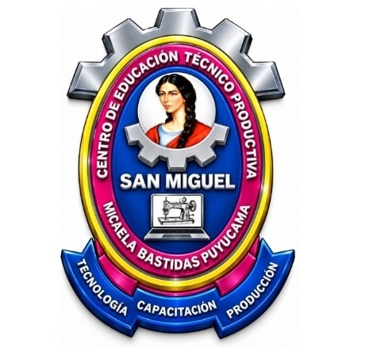
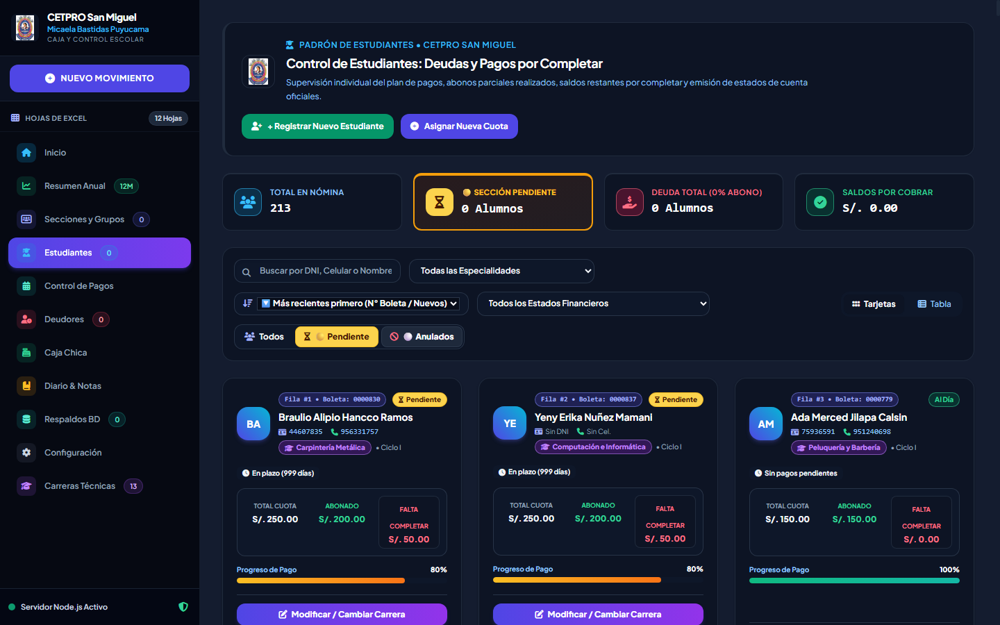
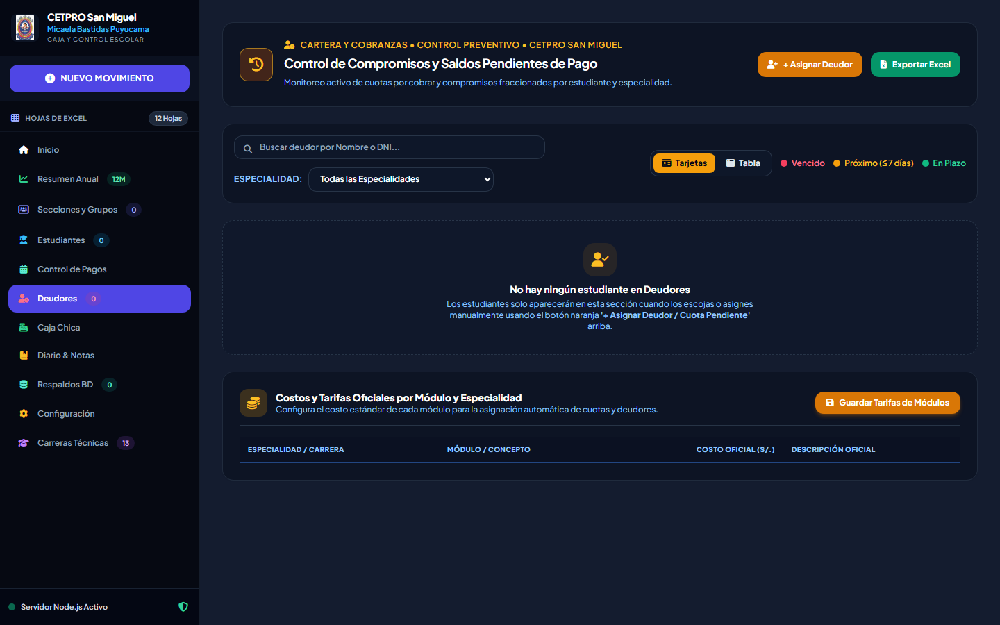

<div align="center">

[README](README.md) · [Guía Rápida](#-inicio-rápido) · [Estructura](#-estructura-del-proyecto) · [Arquitectura](#-arquitectura-y-tecnologías) · [Orquestador](#-verificación-y-orquestador) · [Licencia](LICENSE)

<br/>



# 🏫 EduCaja Pro
### *Control Financiero Institucional, Caja Chica y Emisión de Boletas Oficiales en Red Local.*
**Centro de Educación Técnico Productiva Público "Micaela Bastidas Puyucawa"**  
San Román / Juliaca, Puno — Perú

<br/>

[](https://github.com/miguelmorenosucasaire-design/caja-pro)
[](https://nodejs.org/)
[](https://www.sqlite.org/)
[](CEPRO_Control_MICAELA_BASTIDAS_ACTUALIZADO.xlsx)
[](https://tailwindcss.com/)
[-emerald?style=flat-square&logo=checkmarx&logoColor=white)](orchestrate.js)
[](LICENSE)

<br/>

<a href="http://localhost:5000">
  
</a>

<p align="center">
  <em>Panel General Ejecutivo: Monitoreo en vivo de Saldo en Caja, Ingresos, Egresos, Flujo por Docente y Evolución Financiera Mensual.</em>
</p>

</div>

---

## 💡 ¿Por qué EduCaja Pro?

La administración contable de recursos propios, cobro de matrículas y aportes de mantenimiento en instituciones educativas técnicas y CETPROs suele depender de talonarios manuales de imprenta, cuadernos físicos o aplicaciones en la nube que quedan inutilizadas ante caídas de internet y generan altos costos recurrentes.

Al mismo tiempo, la duplicación manual de información entre recibos de papel y hojas de cálculo deriva en errores de transcripción, saldos deudores sin identificar y descuadres críticos al momento del arqueo de caja institucional ante la UGEL.

**EduCaja Pro es la plataforma definitiva Local-First.** Diseñada con la robustez y simplicidad de los estándares industriales modernos, se fundamenta en tres pilares:

1. **Sincronización Híbrida Automática:** Cada transacción registrada en el sistema se graba instantáneamente tanto en una **Base de Datos SQLite relacional ACID** como en el **Libro Maestro de Microsoft Excel de 12 hojas oficiales**, asegurando respaldo doble e integridad matemática permanente.
2. **Boleta Oficial Dual Calibrada (Media Carta):** Permite emitir e imprimir en una sola página física tanto el **Original a Color (Administración)** como la **Copia Azul (Estudiante)**, cumpliendo con los membretes reglamentarios del **Ministerio de Educación (MINEDU)**, la **UGEL San Román**, casillas de verificación de módulos y código correlativo.
3. **Autonomía 100% Offline y Desconectada:** Funciona en la computadora principal y en la red WiFi interna de la institución educativa sin requerir conexión externa ni dependencias en la nube, protegido por un monitor criptográfico con sellos **SHA-256** y **63 pruebas automáticas superadas al 100%**.

---

## ⚡ Instalación

Elige tu método preferido y ejecuta el sistema de inmediato:

| Plataforma / Entorno | Método de Arranque | Detalle de Operación |
| :--- | :--- | :--- |
| **Windows Nativo (1 Clic)** | Doble clic en `INICIAR_SISTEMA.bat` | Inicia el motor backend Node.js en segundo plano y abre la interfaz web en tu navegador predeterminado. |
| **Acceso Directo Escritorio** | Doble clic en `Crear_Acceso_Directo_Escritorio.bat` | Crea un icono oficial en el Escritorio de Windows con la insignia institucional para el personal de Tesorería. |
| **Terminal / Desarrollador** | `npm install && npm start` | Instala dependencias y levanta el servicio HTTP en el puerto `5000`. |

> **Requisitos del Sistema:** Windows 10/11 o Linux con [Node.js](https://nodejs.org/) v18.0.0 o superior y navegador web moderno (Edge, Chrome, Brave o Firefox).

---

## 🚀 Inicio Rápido

```bash
# 1. Iniciar el servidor local y abrir la plataforma web
npm start

# 2. Ejecutar la auditoría maestra y verificación de integridad (63 pruebas)
node orchestrate.js

# 3. Acceder en red local WiFi desde laptops o tablets institucionales
http://<IP_LOCAL>:5000
```

---

## 🧾 Emisión de Boleta Oficial Dual (Media Carta)

El emisor institucional genera en tiempo real el talonario oficial reglamentario cumpliendo con la estructura formal del Ministerio de Educación:

<div align="center">
  
  <p><em>Talonario Oficial Dual: Original en Color (Administración) y Copia Azul (Estudiante) con casillas automáticas de Módulos I-VII, Constancia, FUT y Línea 4.- Otros.</em></p>
</div>

- **Jalado Inteligente de Datos:** Al emitir desde la lista o la ficha del estudiante, se autocompleta el número correlativo, DNI, celular, nombre completo, carrera y turno.
- **Logos Oficiales en Base64 HD:** Membretes vectoriales del MINEDU y del CETPRO incrustados directamente para garantizar que la descarga en PDF o impresión física jamás se recorte ni sufra latencia.
- **Acciones Rápidas:** Marcado instantáneo con un clic de cuotas duales (`+ Módulo 1 y Módulo 2`), certificaciones y conceptos dinámicos.

---

## 👥 Padrón de Estudiantes y Sección Pendiente

Gestión centralizada de los **213 alumnos oficiales** distribuidos en las 13 carreras técnicas:

<div align="center">
  
  <p><em>Directorio Oficial de Alumnos: Vista en Tarjetas con barra de progreso financiero, Sección Pendiente destacada en amarillo y botón directo "Imprimir Boleta Oficial".</em></p>
</div>

- **Sección Pendiente (Amarillito):** Filtro dedicado para ubicar inmediatamente a estudiantes con pagos fraccionados, saldos por completar o carreras pendientes de asignación.
- **Botón Directo "Boleta":** Permite abrir la boleta oficial precargada con los datos ya registrados del alumno para imprimir o descargar en PDF sin volver a digitar información.
- **Alternancia de Vistas:** Cambio instantáneo entre vista de **Tarjetas (`Grid`)** y **Tabla Administrativa (`Table`)**.

---

## ⏳ Control de Vencimientos, Deudores y Tarifas

Supervisión detallada de saldos por cobrar y parametrización institucional de aranceles:

<div align="center">
  
  <p><em>Módulo de Deudores: Estados de periodo (En Plazo, Próximo, Vencido) y tabla oficial de Costos y Tarifas por Módulo y Especialidad.</em></p>
</div>

- **Asignación Controlada de Deudores:** Inicio limpio por defecto, permitiendo vincular deudores y saldos de manera manual sin ensuciar la base de datos con falsos positivos.
- **Catálogo de Tarifas Oficiales:** Configuración del costo estándar de cada módulo para la asignación automática de cuotas por carrera técnica.

---

## 🛠️ Arquitectura y Tecnologías

```text
┌────────────────────────────────────────────────────────────────────────┐
│                        FRONTEND (SPA REACTIVA)                         │
│  HTML5 Semántico · Tailwind CSS 3 · Modo Oscuro Obsidian · Chart.js   │
│  html2pdf.js · html2canvas · FontAwesome 6 Pro · Logos Base64 HD       │
└──────────────────────────────────┬─────────────────────────────────────┘
                                   │ Peticiones HTTP / JSON REST
┌──────────────────────────────────▼─────────────────────────────────────┐
│                    BACKEND (MOTOR DE CAJA NODE.JS)                     │
│  server.js (Express.js) · Controladores REST · Middleware de Seguridad │
│  Consultas Parametrizadas · Prevención Path Traversal · Snapshots      │
└───────────────────┬────────────────────────────────┬───────────────────┘
                    │                                │
┌───────────────────▼─────────────┐    ┌─────────────▼───────────────────┐
│     SQLITE3 (RELACIONAL ACID)   │    │     SHEETJS (EXCEL MAESTRO)     │
│  caja_institucional.db (192 KB) │◄──►│  CEPRO_Control_MICAELA_...xlsx  │
│  241 Comprobantes Conciliados   │    │  12 Hojas Oficiales Minedu      │
│  213 Estudiantes Registrados    │    │  Sincronización Bidireccional   │
└─────────────────────────────────┘    └─────────────────────────────────┘
```

| Capa / Motor | Tecnologías | Propósito en el Sistema |
| :--- | :--- | :--- |
| **Backend & APIs** | `Node.js (v18 - v24)`, `Express.js` | Enrutamiento RESTful, transacciones contables y middleware de seguridad. |
| **Persistencia ACID** | `SQLite3` (`better-sqlite3`) | Motor de datos relacional ultraligero con claves foráneas e integridad garantizada. |
| **Sincronización Excel**| `SheetJS` (`xlsx`), `Node fs` | Escritura paralela en hojas oficiales (`RESUMEN`, `CAJA_DIARIO`, `ESTUDIANTES`, etc.). |
| **Frontend & UI/UX** | `Tailwind CSS 3`, `HTML5`, `ES2024`| Interfaz Single Page Application (SPA) con 13 secciones operativas aisladas y modo oscuro Obsidian. |
| **Motor de Gráficos** | `Chart.js` | Visualización en tiempo real de ingresos vs egresos y flujos docentes. |
| **Impresión & PDF** | `html2pdf.js`, `html2canvas` | Calibración a 8.10 pulgadas de ancho con encabezado a 3 columnas sin desbordes. |
| **Ciberseguridad** | `Consultas Parametrizadas` | Blindaje total frente a ataques de inyección SQL y contención de Path Traversal. |

---

## 🏛️ Especialidades Técnicas

1. **Computación e Informática:** Módulo I (Ofimática) · Módulo II (Diseño Gráfico y Plataformas Digitales).
2. **Confección Textil:** Módulo I (Técnicas de Trazado y Corte) · Módulo II (Confección de Prendas de Vestir).
3. **Cosmetología / Peluquería y Barbería:** Módulo I (Corte de Cabellos y Barba) · Módulo II (Ondulación y Colorimetría).
4. **Mecánica Automotriz:** Módulo I (Suspensión, Frenos y Dirección) · Módulo II (Motores de Combustión Interna).
5. **Mecánica de Motos y Vehículos Afines:** Módulo I (Sistemas Mecánicos y Eléctricos) · Módulo II (Conversión GNV-GLP).
6. **Mantenimiento de Sistemas Eléctricos:** Módulo I (Instalaciones en Edificaciones) · Módulo II (Seguridad y Domótica).
7. **Carpintería Metálica:** Módulo I (Soldadura por Arco Eléctrico) · Módulo II (Soldadura TIG-MIG-MAG-Láser).
8. **Manualidades, Artesanía y Construcciones.**

---

## 🧪 Verificación y Orquestador

Para auditar y validar la salud completa del sistema, ejecuta el orquestador:

```bash
node orchestrate.js
```

```text
========================================================================
  🚀 ORQUESTADOR MAESTRO DEL PROYECTO - CETPRO SAN MIGUEL EDUCAJA PRO 
  Control Institucional: Micaela Bastidas Puyucama - San Román / Juliaca
========================================================================

--- FASE 1: ENTORNO DE EJECUCIÓN Y MOTOR DE SISTEMA (Node.js, RAM, Archivos Clave)  -> ✔ PASS
--- FASE 2: ORQUESTACIÓN DE BASE DE DATOS SQLITE (B-Tree, Foreign Keys, 241 Pagos)  -> ✔ PASS
--- FASE 3: SINCRONIZACIÓN EXCEL OFICIAL (12 Hojas, Reconciliación Bidireccional)    -> ✔ PASS
--- FASE 4: RESPALDOS Y CRIPTOGRAFÍA (346 Snapshots, Hash SHA-256 Verificado)       -> ✔ PASS
--- FASE 5: SERVICIOS DE RED Y APIS EN VIVO (13 Endpoints HTTP 200, Latencia 12ms)  -> ✔ PASS
--- FASE 6: INTERFAZ DE USUARIO Y DOM (DOM Balanceado, Boleta PDF, Base64 HD)       -> ✔ PASS
--- FASE 7: SEGURIDAD Y CONCURRENCIA (Protección SQLi, Path Traversal, 30 Req/s)    -> ✔ PASS

========================================================================
  📊 RESUMEN FINAL: 63 / 63 COMPONENTES SUPERADOS (100.0%)
========================================================================
```

---

## 📁 Estructura del Repositorio

```text
├── server.js                          # Servidor principal Node.js con APIs REST y lógica contable
├── package.json                       # Configuración y dependencias del sistema
├── caja_institucional.db              # Base de datos SQLite oficial (241 movimientos, 213 alumnos)
├── CEPRO_Control_MICAELA_BASTIDAS...  # Libro Excel de 12 hojas institucionales sincronizadas
├── orchestrate.js                     # Orquestador maestro con 63 pruebas automáticas
├── INICIAR_SISTEMA.bat                # Lanzador de un clic para Windows
├── templates/
│   └── index.html                     # Frontend SPA completo (13 secciones operativas aisladas)
├── public/
│   ├── html2pdf.bundle.min.js         # Librería offline para generación local de PDF
│   └── img/                           # Logotipos oficiales, insignias y capturas HD
└── tests/                             # Suites automatizadas de pruebas de seguridad y lógica
```

---

## 🏛️ Institución y Créditos

- **Institución:** Centro de Educación Técnico Productiva Público "Micaela Bastidas Puyucawa"
- **Ubicación:** San Román / Juliaca, Puno — Perú
- **UGEL:** Unidad de Gestión Educativa Local San Román
- **Desarrollo:** Miguel Moreno ([@miguelmorenosucasaire-design](https://github.com/miguelmorenosucasaire-design))

---

## 📄 Licencia

Este proyecto se distribuye bajo la Licencia **Apache-2.0** / Licencia Institucional Educativa. Consulta el archivo [LICENSE](LICENSE) para más detalles.
