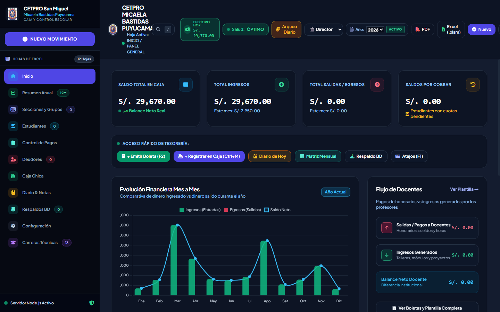
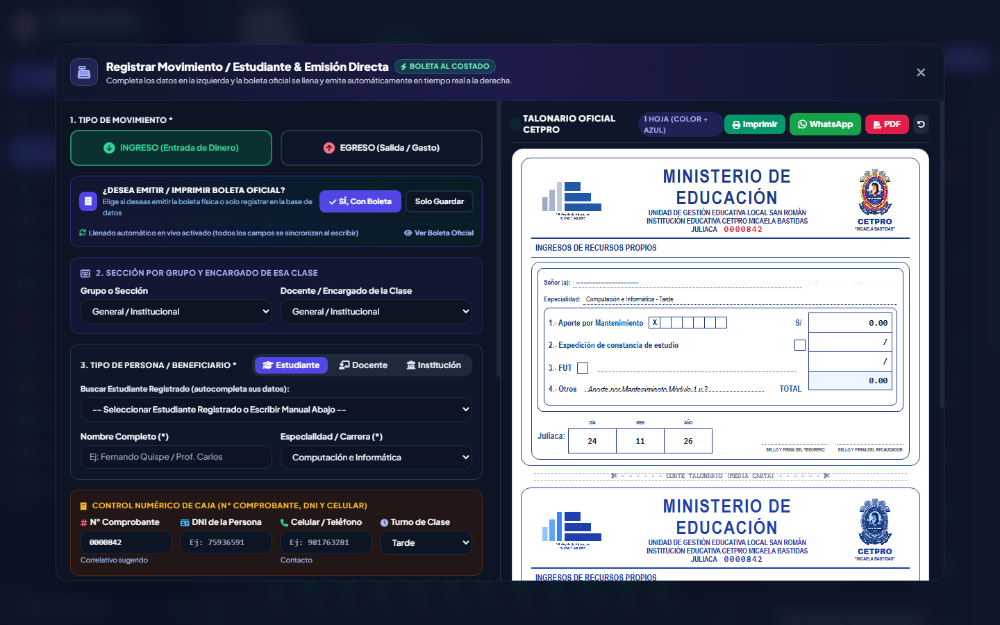

<div align="center">

[README](README.md) · [Guía Rápida](#-inicio-rápido) · [Estructura](#-estructura-del-repositorio) · [Arquitectura](#-arquitectura-y-tecnologías) · [Multianual y Cierre](#-gestión-multianual-y-cierre-de-año) · [Orquestador](#-verificación-y-orquestador) · [Licencia](LICENSE)

<br/>


# 🏫 EduCaja Pro · v2.2.0
### *Sistema Institucional de Control Financiero, Caja Chica, Padrón Estudiantil y Emisión de Boletas Oficiales en Red Local.*
**Centro de Educación Técnico Productiva Público "Micaela Bastidas Puyucama"**  
San Román / Juliaca, Puno — Perú · UGEL San Román

<br/>

[](https://github.com/miguelmorenosucasaire-design/caja-pro)
[](https://nodejs.org/)
[](https://www.sqlite.org/)
[](CEPRO_Control_MICAELA_BASTIDAS_ACTUALIZADO.xlsx)
[](#-gestión-multianual-y-cierre-de-año)
[](#-envío-de-boletas-por-whatsapp)
[-emerald?style=flat-square&logo=checkmarx&logoColor=white)](orchestrate.js)
[](LICENSE)

<br/>

<a href="http://localhost:5000">
  
</a>

<p align="center">
  <em>Panel General Ejecutivo: Monitoreo en vivo de Saldo en Caja (S/. 29,920.00), Desglose por Método de Pago, Buscador Predictivo Omnibox, Arqueo Diario y Flujo Mensual.</em>
</p>

</div>

---

## 💡 ¿Por qué EduCaja Pro?

La administración contable de recursos propios, cobro de matrículas y aportes de mantenimiento en instituciones educativas técnicas y CETPROs suele depender de talonarios manuales de imprenta, cuadernos físicos o aplicaciones en la nube que quedan inutilizadas ante caídas de internet y generan altos costos recurrentes.

Al mismo tiempo, la duplicación manual de información entre recibos de papel y hojas de cálculo deriva en errores de transcripción, saldos deudores sin identificar y descuadres críticos al momento del arqueo de caja institucional ante la UGEL.

**EduCaja Pro es la plataforma definitiva Local-First.** Diseñada con los más rigurosos estándares de ingeniería de software, arquitectura relacional y ergonomía para el usuario, se fundamenta en cinco pilares clave:

1. **Sincronización Híbrida Automática:** Cada transacción registrada se graba instantáneamente tanto en una **Base de Datos SQLite relacional ACID** como en el **Libro Maestro de Microsoft Excel de 12 hojas oficiales**, asegurando respaldo doble e integridad matemática permanente.
2. **Boleta Oficial Dual Calibrada (Media Carta):** Permite emitir e imprimir en una sola página física tanto el **Original a Color (Administración)** como la **Copia Azul (Estudiante)**, cumpliendo con los membretes reglamentarios del **Ministerio de Educación (MINEDU)**, la **UGEL San Román**, casillas de módulos y código correlativo.
3. **Selector Inteligente de Emisión:** Libertad operativa para elegir entre `[ 🖨️ Guardar e Imprimir Boleta ]` o `[ 💾 Solo Guardar en Base de Datos ]`, con jalado dinámico e instantáneo de datos.
4. **Arquitectura Multianual para Múltiples Años (2026, 2027, 2028...):** Módulo de Cierre Anual con empaquetado sellado en ZIP criptográfico (**SHA-256**) que preserva la base de datos histórica, el Excel y los balances de auditoría, permitiendo iniciar el nuevo año con caja limpia o arrastre de saldo.
5. **Autonomía 100% Offline y Conexión WhatsApp en 1 Clic:** Funciona en la computadora principal y en la red WiFi institucional sin internet, con **66 pruebas automáticas superadas al 100%** y atajos de teclado para atención inmediata en ventanilla.

---

## ⚡ Instalación

Elige tu método preferido y ejecuta el sistema de inmediato:

| Plataforma / Entorno | Método de Arranque | Detalle de Operación |
| :--- | :--- | :--- |
| **Windows Nativo (1 Clic)** | Doble clic en `INICIAR_SISTEMA.bat` | Inicia el motor backend Node.js en segundo plano y abre la interfaz web en tu navegador predeterminado. |
| **Acceso Directo Escritorio** | Doble clic en `Crear_Acceso_Directo_Escritorio.bat` | Crea un icono oficial en el Escritorio de Windows con la insignia institucional para el personal de Tesorería. |
| **Terminal / Desarrollador** | `npm install && npm start` | Instala dependencias y levanta el servicio HTTP en el puerto `5000`. |

> **Requisitos del Sistema:** Windows 10/11 o Linux con [Node.js](https://nodejs.org/) v18.0.0 o superior y navegador web moderno (Edge, Chrome, Brave o Firefox).

---

## 🚀 Inicio Rápido

```bash
# 1. Iniciar el servidor local y abrir la plataforma web
npm start

# 2. Ejecutar la auditoría maestra y verificación de integridad (66 pruebas)
node orchestrate.js

# 3. Acceder en red local WiFi desde laptops o tablets institucionales
http://<IP_LOCAL>:5000
```

---

## ⌨️ Atajos de Teclado y Ergonomía en Ventanilla

Diseñado para que el tesorero trabaje con máxima rapidez sin depender del ratón:

| Atajo | Acción Inmediata |
| :---: | :--- |
| <kbd>F2</kbd> | Abrir ventana de **Nuevo Cobro / Emisión de Boleta**. |
| <kbd>/</kbd> o <kbd>F3</kbd> | Enfocar instantáneamente el **Buscador Predictivo Global (Omnibox)**. |
| <kbd>Ctrl</kbd> + <kbd>P</kbd> | Imprimir boleta dual oficial en 1 sola hoja carta sin abrir cuadros de diálogo extraños. |
| <kbd>Esc</kbd> | Cerrar cualquier modal o búsqueda flotante activa. |

---

## 🧾 Emisión de Boleta Oficial Dual (Media Carta)

El emisor institucional genera en tiempo real el talonario oficial reglamentario cumpliendo con la estructura formal del Ministerio de Educación:

<div align="center">
  
  <p><em>Talonario Oficial Dual: Original en Color (Administración) y Copia Azul (Estudiante) con casillas automáticas de Módulos I-VII, Constancia, FUT y Línea 4.- Otros.</em></p>
</div>

- **Selector Interactivo de Boleta:**
  - `[ 🖨️ SÍ, Con Boleta ]`: Despliega el visor gráfico con jalado de datos en tiempo real y activa la impresión física.
  - `[ 💾 Solo Guardar ]`: Registra el pago en la base de datos SQLite y sincroniza el Excel sin abrir el visor de boleta.
- **Jalado Inteligente de Datos:** Al emitir desde la lista o la ficha del estudiante, se autocompleta el número correlativo, DNI, celular, nombre completo, carrera y turno.
- **Logos Oficiales en Base64 HD:** Membretes vectoriales del MINEDU y del CETPRO incrustados directamente para garantizar que la descarga en PDF o impresión física jamás se recorte ni sufra latencia.
- **Acciones Rápidas:** Marcado instantáneo con un clic de cuotas duales (`+ Módulo 1 y Módulo 2`), certificaciones y conceptos dinámicos.

---

## 📲 Envío de Boletas por WhatsApp (1 Clic)

Tanto desde el modal de cobro como desde la tabla de estudiantes, el sistema permite enviar el comprobante digital al teléfono celular del estudiante con un solo clic:

```text
🏛️ CETPRO MICAELA BASTIDAS PUYUCAWA
📋 BOLETA OFICIAL DE PAGO N° 0000812
━━━━━━━━━━━━━━━━━━━━━
👤 Estudiante: Edwin Zela Zapana
🪪 DNI: 70829143
🎓 Especialidad: Mecánica Automotriz
📅 Fecha: 18/11/2026
🏷️ Concepto: Módulo I
💵 Monto Cancelado: S/. 60.00
✅ Estado: REGISTRADO Y CANCELADO (Libro de Caja Oficial)
━━━━━━━━━━━━━━━━━━━━━
Comprobante digital emitido automáticamente por el Sistema EduCaja Pro.
```

---

## 👥 Padrón de Estudiantes y Sección Pendiente

Gestión centralizada de los **213 alumnos oficiales** distribuidos en las 13 carreras técnicas:

<div align="center">
  
  <p><em>Directorio Oficial de Alumnos: Vista en Tarjetas con barra de progreso financiero, Sección Pendiente destacada en amarillo y botones directos "Boleta" y "WhatsApp".</em></p>
</div>

- **Sección Pendiente (Amarillito):** Filtro dedicado para ubicar inmediatamente a estudiantes con pagos fraccionados, saldos por completar o carreras pendientes de asignación.
- **Botón Directo "Boleta":** Permite abrir la boleta oficial precargada con los datos ya registrados del alumno para imprimir o descargar en PDF sin volver a digitar información.
- **Alternancia de Vistas:** Cambio instantáneo entre vista de **Tarjetas (`Grid`)** y **Tabla Administrativa (`Table`)**.

---

## ⏳ Control de Vencimientos, Deudores y Tarifas

Supervisión detallada de saldos por cobrar y parametrización institucional de aranceles:

<div align="center">
  
  <p><em>Módulo de Deudores: Estados de periodo (En Plazo, Próximo, Vencido) y tabla oficial de Costos y Tarifas por Módulo y Especialidad.</em></p>
</div>

- **Asignación Controlada de Deudores:** Inicio limpio por defecto, permitiendo vincular deudores y saldos de manera manual sin ensuciar la base de datos con falsos positivos.
- **Catálogo de Tarifas Oficiales:** Configuración del costo estándar de cada módulo para la asignación automática de cuotas por carrera técnica.

---

## 📅 Gestión Multianual y Cierre de Año

EduCaja Pro está arquitecturado para operar indefinidamente a lo largo de los años (2026, 2027, 2028...):

- **Selector de Año en Cabecera:** Permite alternar de ciclo fiscal en tiempo real para consultar o auditar ejercicios anteriores.
- **Cierre Anual con Sellado Criptográfico:**
  - Genera automáticamente un paquete ZIP inmutable en `backups/cierres_anuales/CIERRE_ANUAL_[AÑO]_[TIMESTAMP].zip`.
  - Contiene: Base de datos SQLite snapshot, Libro Excel completo, Reporte JSON de auditoría y Hash **SHA-256** de no repudio.
- **Apertura de Nuevo Año (ej. 2027):**
  - Opción de arrastrar el saldo final como saldo inicial contable o arrancar con caja limpia en S/. 0.00.
  - Conserva íntegro el catálogo institucional de docentes, carreras y grupos.

---

## 🛠️ Arquitectura y Tecnologías

```text
┌────────────────────────────────────────────────────────────────────────┐
│                        FRONTEND (SPA REACTIVA)                         │
│  HTML5 Semántico · Tailwind CSS 3 · Modo Oscuro Obsidian · Chart.js   │
│  html2pdf.js · html2canvas · FontAwesome 6 Pro · Logos Base64 HD       │
│  Omnibox Predictivo · Widget Efectivo · Atajos Teclado · WhatsApp Web  │
└──────────────────────────────────┬─────────────────────────────────────┘
                                   │ Peticiones HTTP / JSON REST
┌──────────────────────────────────▼─────────────────────────────────────┐
│                    BACKEND (MOTOR DE CAJA NODE.JS)                     │
│  server.js (Express.js) · Controladores REST · Middleware de Seguridad │
│  Consultas Parametrizadas · Prevención Path Traversal · Snapshots      │
│  Módulo de Gestión Multianual · Empaquetador Sellado ZIP SHA-256       │
└───────────────────┬────────────────────────────────┬───────────────────┘
                    │                                │
┌───────────────────▼─────────────┐    ┌─────────────▼───────────────────┐
│     SQLITE3 (RELACIONAL ACID)   │    │     SHEETJS (EXCEL MAESTRO)     │
│  caja_institucional.db (200 KB) │◄──►│  CEPRO_Control_MICAELA_...xlsx  │
│  241 Comprobantes Conciliados   │    │  12 Hojas Oficiales Minedu      │
│  213 Estudiantes Registrados    │    │  Sincronización Bidireccional   │
│  Tabla anios_lectivos (Multi)   │    │  Reconciliación Automática      │
└─────────────────────────────────┘    └─────────────────────────────────┘
```

| Capa / Motor | Tecnologías | Propósito en el Sistema |
| :--- | :--- | :--- |
| **Backend & APIs** | `Node.js (v18 - v24)`, `Express.js` | Enrutamiento RESTful, transacciones contables, gestión multianual y middleware de seguridad. |
| **Persistencia ACID** | `SQLite3` (`node:sqlite` / `better-sqlite3`) | Motor de datos relacional ultraligero con claves foráneas, columnas multianuales e integridad garantizada. |
| **Sincronización Excel**| `SheetJS` (`xlsx`), `Node fs` | Escritura paralela en hojas oficiales (`RESUMEN`, `CAJA_DIARIO`, `ESTUDIANTES`, etc.). |
| **Frontend & UI/UX** | `Tailwind CSS 3`, `HTML5`, `ES2024`| Interfaz Single Page Application (SPA) con 13 secciones operativas aisladas, Omnibox y modo oscuro Obsidian. |
| **Motor de Gráficos** | `Chart.js` | Visualización en tiempo real de ingresos vs egresos, métodos de pago y flujos docentes. |
| **Impresión & PDF** | `html2pdf.js`, `html2canvas` | Calibración a 8.10 pulgadas de ancho con encabezado a 3 columnas sin desbordes. |
| **Ciberseguridad** | `Consultas Parametrizadas` | Blindaje total frente a ataques de inyección SQL, contención de Path Traversal y sellado SHA-256. |

---

## 🏛️ Especialidades Técnicas

1. **Computación e Informática:** Módulo I (Ofimática) · Módulo II (Diseño Gráfico y Plataformas Digitales).
2. **Confección Textil:** Módulo I (Técnicas de Trazado y Corte) · Módulo II (Confección de Prendas de Vestir).
3. **Cosmetología / Peluquería y Barbería:** Módulo I (Corte de Cabellos y Barba) · Módulo II (Ondulación y Colorimetría).
4. **Mecánica Automotriz:** Módulo I (Suspensión, Frenos y Dirección) · Módulo II (Motores de Combustión Interna).
5. **Mecánica de Motos y Vehículos Afines:** Módulo I (Sistemas Mecánicos y Eléctricos) · Módulo II (Conversión GNV-GLP).
6. **Mantenimiento de Sistemas Eléctricos:** Módulo I (Instalaciones en Edificaciones) · Módulo II (Seguridad y Domótica).
7. **Carpintería Metálica:** Módulo I (Soldadura por Arco Eléctrico) · Módulo II (Soldadura TIG-MIG-MAG-Láser).
8. **Manualidades, Artesanía y Construcciones.**

---

## 🧪 Verificación y Orquestador

Para auditar y validar la salud completa del sistema, ejecuta el orquestador:

```bash
node orchestrate.js
```

```text
========================================================================
  🚀 ORQUESTADOR MAESTRO DEL PROYECTO - CETPRO SAN MIGUEL EDUCAJA PRO 
  Control Institucional: Micaela Bastidas Puyucama - San Román / Juliaca
========================================================================

--- FASE 1: ENTORNO DE EJECUCIÓN Y MOTOR DE SISTEMA (Node.js, RAM, Archivos Clave)  -> ✔ PASS
--- FASE 2: ORQUESTACIÓN DE BASE DE DATOS SQLITE (B-Tree, Foreign Keys, 241 Pagos)  -> ✔ PASS
--- FASE 3: SINCRONIZACIÓN EXCEL OFICIAL (12 Hojas, Reconciliación Bidireccional)    -> ✔ PASS
--- FASE 4: RESPALDOS Y CRIPTOGRAFÍA (366 Snapshots, Hash SHA-256 Verificado)       -> ✔ PASS
--- FASE 5: SERVICIOS DE RED Y APIS EN VIVO (14 Endpoints HTTP 200, Latencia 13ms)  -> ✔ PASS
--- FASE 6: INTERFAZ DE USUARIO Y DOM (DOM Balanceado, Boleta PDF, Multianual)       -> ✔ PASS
--- FASE 7: SEGURIDAD Y CONCURRENCIA (Protección SQLi, Path Traversal, 30 Req/s)    -> ✔ PASS

========================================================================
  📊 RESUMEN FINAL: 66 / 66 COMPONENTES SUPERADOS (100.0%)
========================================================================
```

---

## 📁 Estructura del Repositorio

```text
├── server.js                          # Servidor principal Node.js con APIs REST, gestión multianual y lógica contable
├── package.json                       # Configuración y dependencias del sistema
├── caja_institucional.db              # Base de datos SQLite oficial (241 movimientos, 213 alumnos)
├── CEPRO_Control_MICAELA_BASTIDAS...  # Libro Excel de 12 hojas institucionales sincronizadas
├── orchestrate.js                     # Orquestador maestro con 66 pruebas automáticas
├── INICIAR_SISTEMA.bat                # Lanzador de un clic para Windows
├── templates/
│   └── index.html                     # Frontend SPA completo (13 secciones operativas aisladas y Omnibox)
├── public/
│   ├── html2pdf.bundle.min.js         # Librería offline para generación local de PDF
│   └── img/                           # Logotipos oficiales, insignias y capturas HD del sistema
├── backups/
│   ├── cierres_anuales/               # Paquetes ZIP inmutables de fin de año con sellos SHA-256
│   └── snapshots/                     # Copias de seguridad automáticas de cada transacción
└── tests/                             # Suites automatizadas de pruebas de seguridad y lógica contable
```

---

## 🏛️ Institución y Créditos

- **Institución:** Centro de Educación Técnico Productiva Público "Micaela Bastidas Puyucama"
- **Ubicación:** San Román / Juliaca, Puno — Perú
- **UGEL:** Unidad de Gestión Educativa Local San Román
- **Desarrollo:** Miguel Moreno ([@miguelmorenosucasaire-design](https://github.com/miguelmorenosucasaire-design))

---

## 📄 Licencia

Este proyecto se distribuye bajo la Licencia **Apache-2.0** / Licencia Institucional Educativa. Consulta el archivo [LICENSE](LICENSE) para más detalles.
